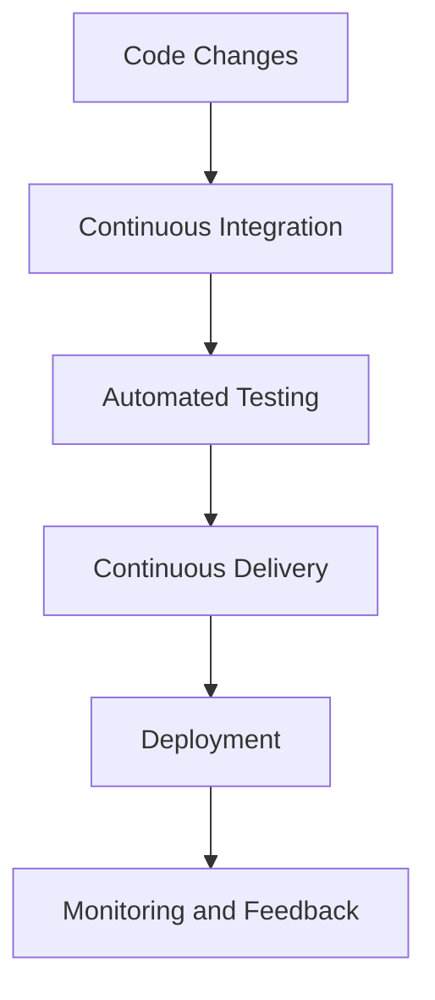
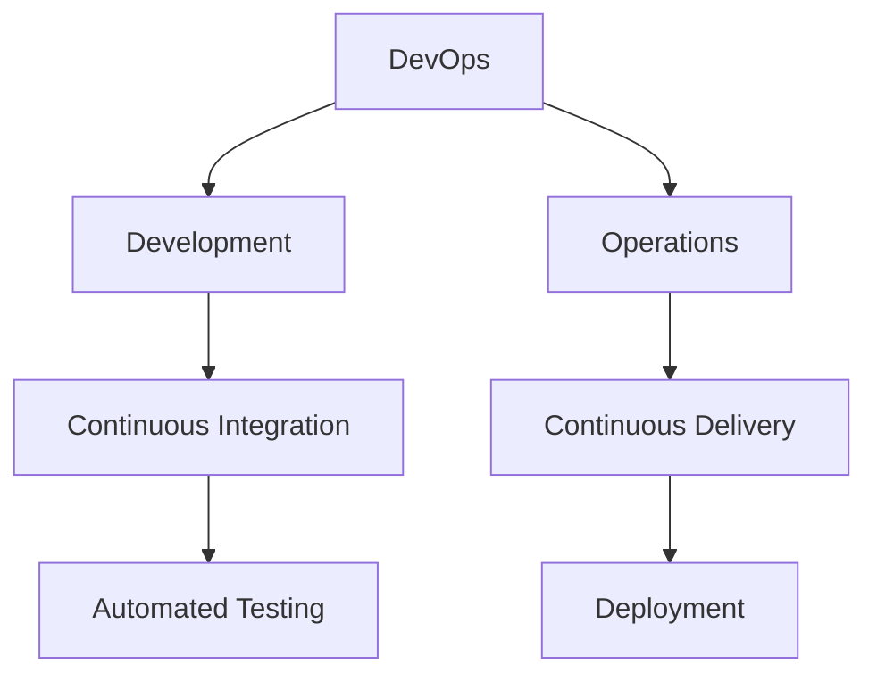

# CICD.webm

**Date:** Apr 16, 2026 | **Duration:** Saved Note

---

## Notes

📌 Overview
The discussion revolves around the concept of **CI-CD**, which stands for **Continuous Integration** and **Continuous Delivery**, a fundamental aspect of **DevOps**. This concept is crucial for companies with **scalable applications**, particularly in the context of **e-commerce**. The importance of **CI-CD** lies in its ability to facilitate efficient and continuous updates to applications, ensuring they remain relevant and effective over time.

📌 Key Themes & Concepts
- **CI-CD**: A core concept in **DevOps** that encompasses **Continuous Integration** and **Continuous Delivery**.
- **DevOps**: A set of practices that combines software development (**Dev**) and IT operations (**Ops**) to improve the speed, quality, and reliability of software releases and deployments.
- **E-commerce Application**: A type of application that supports online shopping and electronic transactions, requiring scalability and continuous updates.
- **Scalable Application**: An application designed to handle increased load and usage without compromising performance, crucial for growing companies.
- **Continuous Integration**: The practice of frequently integrating code changes into a central repository, usually through automated processes.
- **Continuous Delivery**: The practice of ensuring that software is always in a releasable state, allowing for faster and more reliable releases.

📌 Detailed Analysis
## Introduction to CI-CD
The concept of **CI-CD** is introduced as a technical term that stands for **Continuous Integration** and **Continuous Delivery**. This is a key concept within **DevOps**, emphasizing the importance of continuous integration and delivery of software updates. 
## Application to E-commerce
The discussion highlights the relevance of **CI-CD** in the context of **e-commerce applications**, which are **scalable applications**. For such applications, completing development in one go is not feasible due to the need for continuous updates and changes over time. 
## Importance of Continuous Updates
The need for **continuous updates** in **scalable applications** is stressed. As companies grow, their applications must adapt to changing requirements, user demands, and technological advancements. **CI-CD** plays a vital role in this process by facilitating the continuous integration of code changes and the delivery of updates.

📌 Action Items / Summary
- **Implement CI-CD**: Companies with **scalable applications**, especially in **e-commerce**, should adopt **CI-CD** practices to ensure continuous integration and delivery of software updates.
- **Understand DevOps**: Recognize the importance of **DevOps** in combining **development** and **operations** to improve software release and deployment speed, quality, and reliability.
- **Emphasize Continuous Integration and Delivery**: Focus on the practices of **Continuous Integration** and **Continuous Delivery** to maintain **scalable applications** that can adapt to changes and updates efficiently.
- **Monitor and Adapt**: Continuously monitor the application's performance and adapt to changes in user needs, market trends, and technological advancements to ensure the application remains competitive and effective.

## Diagrams

### CI-CD Process

### DevOps and CI-CD Relationship

